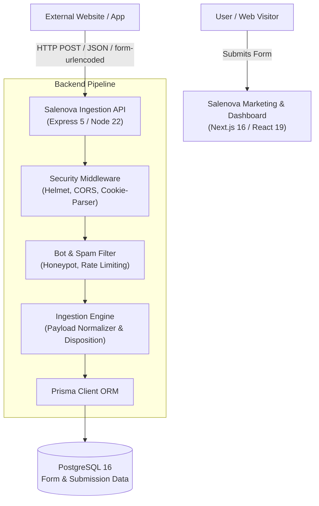
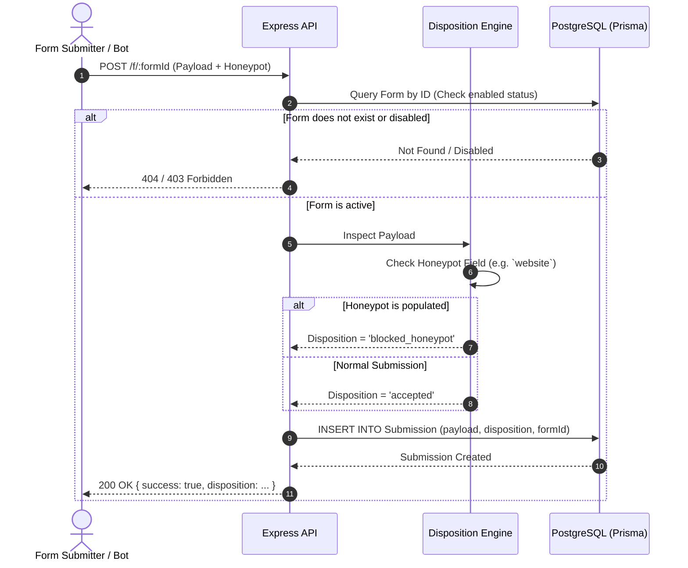

# System Architecture & Technical Design

This document details the software architecture, data flow, component boundaries, and security model for the **Salenova** platform.

---

## 1. Architectural Goals

Salenova is engineered to solve two main problems:
1. **Developer Velocity**: Eliminate the repetitive work of writing bespoke backend handlers, databases, and validation routines for marketing and product forms.
2. **Lead Integrity & Deliverability**: Automatically filter out automated bots, spam crawlers, and junk inquiries before they contaminate CRM databases or notify sales teams.

---

## 2. High-Level Architecture

The system follows a modern decoupled architecture where frontend presentation is separated from backend persistence and ingestion:



---

## 3. Monorepo Organization

Salenova uses a clean workspace separation between the client and server components:

```
crm/
├── client/          # Frontend Web Application (Next.js 16, React 19, Tailwind CSS v4)
├── server/          # REST Ingestion API & Database Services (Express 5, Prisma 6)
├── docs/            # Architecture, API specifications, and database references
└── .github/         # Continuous integration and repository templates
```

### 3.1 Client Architecture (`/client`)

The frontend application adopts a **Feature-Driven Design** pattern:
- **`src/app/`**: Next.js App Router route structure:
  - Landing page, interactive try-it playground, feature matrix, and pricing calculator.
  - Clerk authentication routes (`/sign-in`, `/sign-up`) with dark theme and custom styling.
- **`src/features/`**: Self-contained domain modules:
  - `marketing/`: Feature components (`hero.tsx`, `features-grid.tsx`, `benefits-cross.tsx`, `try-it.tsx`, `pricing.tsx`, `faq.tsx`).
- **`src/proxy.ts`**: Next.js 16 Proxy layer running Clerk authentication middleware (`clerkMiddleware`).
- **`src/shared/`**: Common cross-cutting utility helpers (`cn` / class merging).

### 3.2 Server Architecture (`/server`)

The backend is built with Express 5 on Node.js 22 using TypeScript:
- **Middleware Chain**:
  - `helmet`: Sets secure HTTP response headers.
  - `cors`: Handles cross-origin requests from configured frontend domains.
  - `express.json()`: Parses incoming JSON payloads.
  - `cookie-parser`: Manages secure session and token cookies.
- **Database Access**: Managed strictly through **Prisma ORM**, ensuring type-safe query generation and migration tracking.

---

## 4. Request Lifecycle & Lead Disposition

When a form submission reaches Salenova, it undergoes the following lifecycle:



### Dispositions:
- **`accepted`**: Passed all security validations and ready for CRM review.
- **`blocked_honeypot`**: Form payload contained data in hidden honeypot fields.
- **`rate_limited`**: Submissions originating from an IP exceeding frequency thresholds.
- **`disposable_email`**: Submissions with temporary or throwaway domain addresses.

---

## 5. Security & Spam Mitigation Model

1. **Invisible Honeypot**:
   Legitimate users cannot see or interact with honeypot fields hidden via CSS and `tabindex="-1"`. Automated web crawlers fill out all form inputs blindly, triggering automatic isolation.
2. **CORS Restrictions**:
   Standard public endpoints permit cross-origin form submissions while administrative endpoints require authenticated origins.
3. **Prepared Statements**:
   Prisma ensures parameterized queries, preventing SQL injection vulnerabilities.
4. **Environment Isolation**:
   No credentials or database URLs are hardcoded in version control. All configuration is loaded via environment variables and checked in `.env.example`.

---

## 6. Deployment & Runtime Execution

The backend service is designed as a lightweight, standalone Express 5 application:
- **Runtime**: Node.js 22 LTS with `tsx` for TypeScript execution during development and production.
- **Database**: Connects directly to any PostgreSQL instance (locally or cloud-hosted such as Neon/Supabase) via standard connection strings managed by Prisma ORM.
- **Stateless Architecture**: The API server is completely stateless, enabling simple scaling across platforms (e.g. Render, Railway, AWS EC2, or direct VPS).

## Route modules and dashboard reads

Backend domains live under `server/src/modules/{dashboards,forms,api-keys,ingestion,leads,spam,stats,dashboard}`. Each owns its handlers, services, queries and contracts. `forms & api` contains compatibility exports and URL aliases for existing integrations. New management clients use `/api/dashboards`, `/api/forms`, `/api/api-keys`, `/api/leads`, `/api/spam`, and `/api/stats`. Public submission URLs are unchanged.

The frontend loads route dependencies after resolving workspace identity:

| Route | Page requests on a cold visit |
| --- | --- |
| Overview | `/api/dashboard/overview` |
| Analytics | `/api/dashboard/analytics` |
| Forms | `/api/forms`, `/api/api-keys` |
| Leads | `/api/forms`, `/api/leads` |
| Spam | `/api/forms`, `/api/spam` |
| Settings | None |

Workspace discovery and the server layout onboarding check are separate from these page requests. The quick simulator loads forms on demand. Overview returns six recent leads plus database totals and distributions; analytics returns counts grouped by local hour, form and source/reason for the supported 90-day window. Neither endpoint sends API keys or quarantined payloads. Lead and spam list pages retain their existing full-list filtering/export behavior.

A provider-owned 30-second memory cache reuses recent reads. Successful API mutations invalidate its revision; explicit refresh bypasses freshness. Route changes cancel pending requests, and request IDs plus workspace/environment checks reject late responses. Workspace changes clear cached data. The provider is keyed by authenticated user ID. Modals and detail drawers mount only when opened.

Verification: `npm run test --prefix client`, `npm run build:client`, `npm run build:server`, and `npm run test:isolated --prefix server`. The isolated runner applies migrations to a temporary schema, checks migration drift, and runs submission, HTTP, security, tenant, performance and dashboard read-model checks before removing that schema.

For Windows workspaces with locked build output, `NEXT_BUILD_DIR` can select another dedicated, ignored Next.js build directory (for example `.next/qa-build`). This leaves the default development and production directories unchanged. Prisma generation requires its native engine DLL to be unlocked; backend TypeScript compilation can use the already generated client during local QA.
